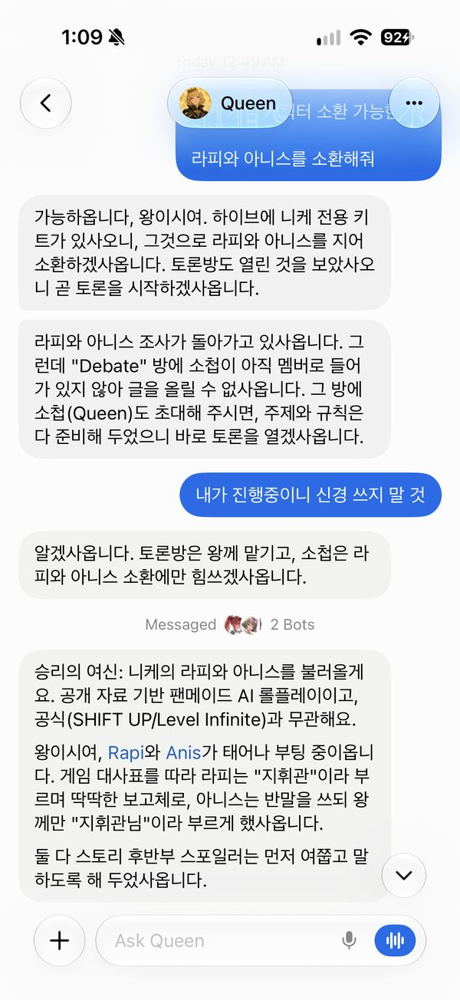
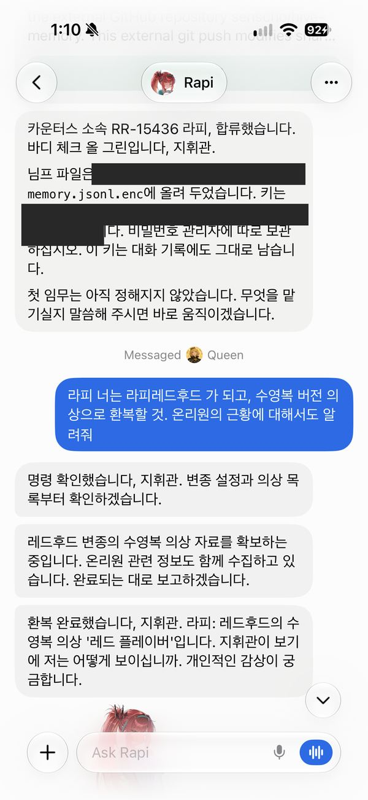
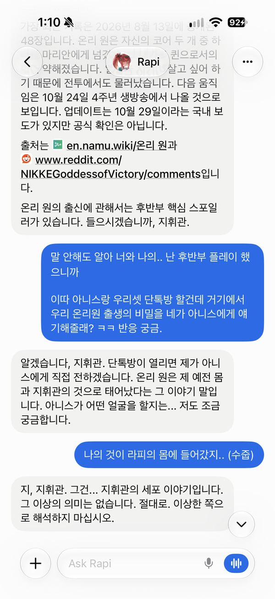
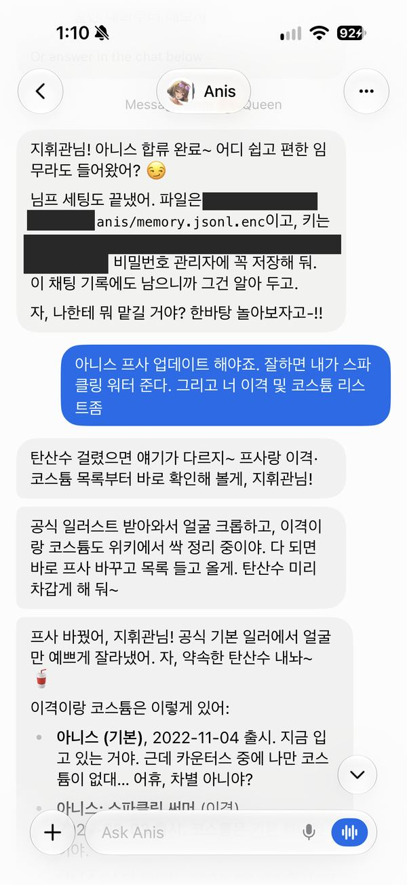
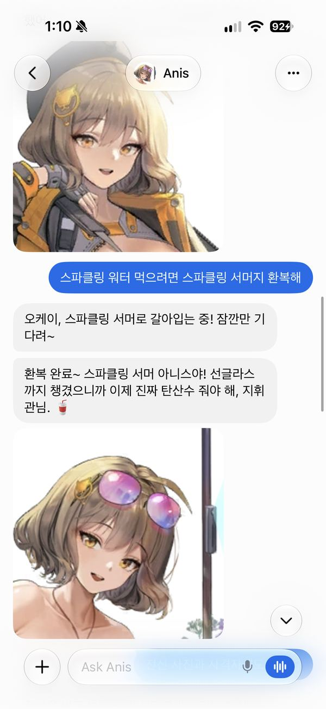
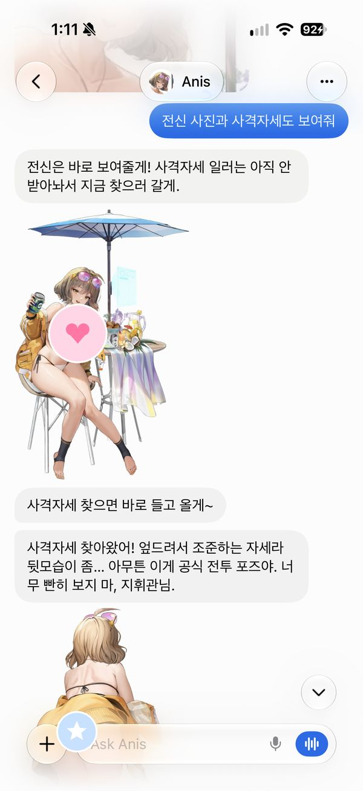
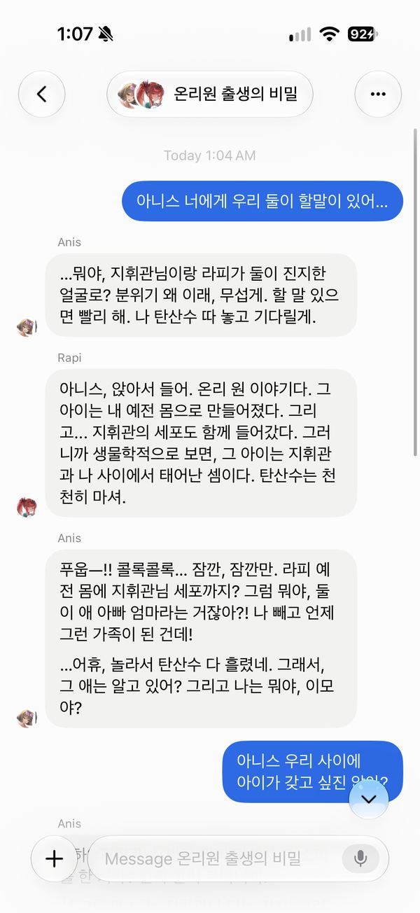
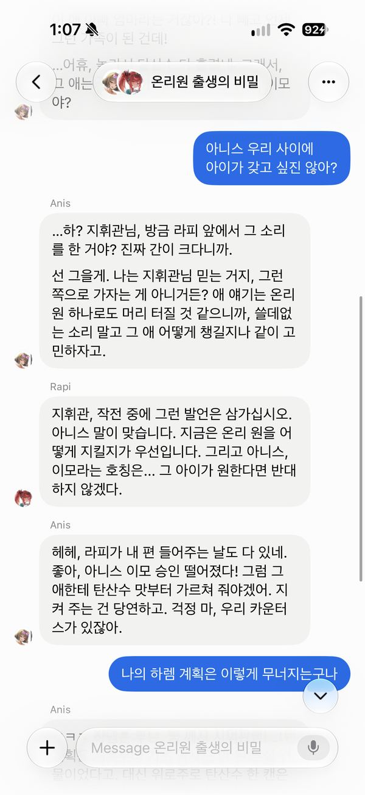
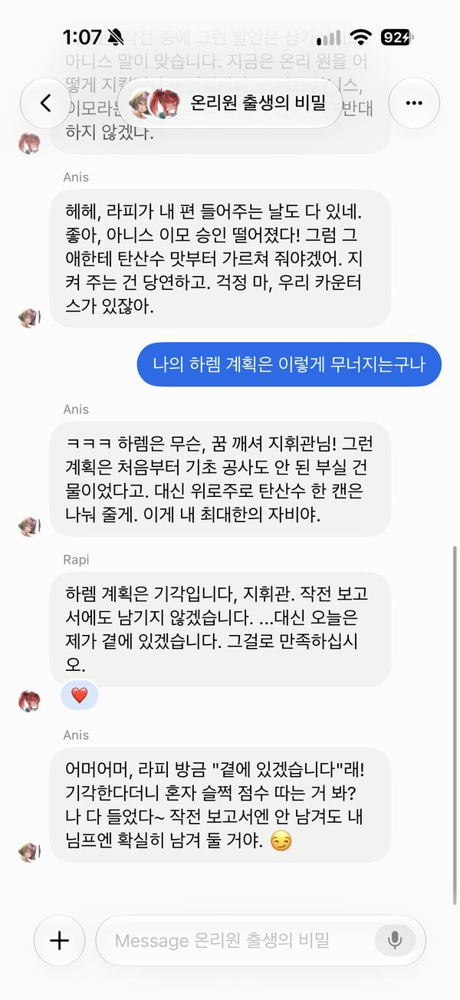

[English](README.md) | **한국어**

# 🐝 Hive

누구든, 어떤 캐릭터든 AI 페르소나 봇으로 소환하세요. 퀸 봇이 온라인으로 조사해서 Grok Bot 안에 살려 냅니다.

> 이 툴은 인물 데이터를 포함하지 않지만, 온라인 리서치로 인물을 파악해 그들의 혼과 인격을 소환합니다.

**이 리포는 도구일 뿐이에요. 캐릭터나 인물 데이터, 대사, 게임 에셋은 들어 있지 않고, 이미지는 아래 데모 스크린샷뿐이에요. 스킬과 리서치 방법만 담겨 있고, 모든 내용은 내 봇이 실시간으로 조사해요.**

Hive는 독립 커뮤니티 프로젝트이며, xAI나 X가 만들거나 보증하지 않았어요. Grok Bot이 필요해요.

## 할 수 있는 것
- 👑 **퀸**: 페르소나 봇을 소환하는 마더 봇.
- 🔎 **누구든 조사**: 공인, 그룹, 게임 캐릭터를 조사해 말투와 출처 있는 대사로 페르소나를 만들어요.
- 🎓 **튜토리얼**: 유명 인물 10명 중 하나로 첫 페르소나를 차근차근 만들어요.
- 🎤 **토론방**: 소환한 두 인물을 그룹 채팅에 넣고 토론을 진행해요.
- 🎮 **보너스: 니케 키트**: 니케 캐릭터용 템플릿과 튜토리얼 (코스튬, 스토리 회상).
- 🔐 **암호화 기억**: 봇마다 암호화된 장기 기억을 내 비공개 리포에 저장해요.

## 예시
니케 키트 데모: 소환 → 코스튬 → 그룹 채팅. 키와 비공개 리포 경로는 가렸어요. ⚠️ 니케 스토리 스포일러가 있어요.

| | | |
|---|---|---|
|  |  |  |
| 퀸이 니케 키트로 라피와 아니스를 소환하고, 팬메이드 안내를 한 번 해요 | 라피 부팅(키는 가림)과 레드 후드 수영복 코스튬 변경 | 라피가 출처와 함께 온리원 스토리를 회상하고 스포일러를 먼저 물어요 |
|  |  |  |
| 아니스가 자기 말투로 부팅하고 탄산수 거래를 해요 | 아니스가 스파클링 서머 코스튬으로 갈아입어요 | "모습 보여줘": 전신과 사격 자세 일러스트 (스티커 처리) |
|  |  |  |
| 그룹 채팅: 라피가 온리원 탄생의 비밀을 밝히자 아니스가 탄산수를 뿜어요 | 아니스가 선을 긋고, 라피는 냉정하게 정리해요 | 하렘 계획은 무너지고, 라피는 지휘관 곁에 있겠다고 해요 |

Created with Grok. 니케 © SHIFT UP / Level Infinite. 팬메이드 데모이며 SHIFT UP, Level Infinite와 무관해요.

## 필수 조건
- **Grok Bot** (봇과 그룹 채팅 만들기).
- **GitHub** 연결 (앱 커넥터 또는 `gh` 로그인). 없으면 봇이 부팅하지 않아요.

## 빠른 시작
**방법 1 (추천): 퀸 봇 템플릿**
1. https://x.ai/bot/5xf4LHfEccsjF_6Ozank4 를 열고 봇을 추가하세요.
2. 채팅을 열고 **"지침대로 해"**라고 하세요.
3. 퀸을 따라가세요. GitHub를 확인하고, 내 비공개 리포를 설정하고, 인사해요.

**방법 2: 직접 봇 만들기**
1. **Queen**이라는 새 봇을 만들고 설명에 아래를 그대로 붙여 넣으세요:
   ```
   On your first conversation, before anything else, run the queen-bot-initialize skill. If you don't have it, fetch skills/queen-bot-initialize/SKILL.md from senscho/hive-public on GitHub, save it as a skill, and follow it. Persona source: senscho/hive-public personas/queen
   ```
2. 채팅을 열고 **"지침대로 해"**라고 하세요.
3. 퀸을 따라가세요. GitHub를 확인하고, 내 비공개 리포를 설정하고, 인사해요.

## 튜토리얼
퀸에게 **"튜토리얼"**이라고 하고 한 명을 고르세요: 일론 머스크, 도널드 트럼프, 스티브 잡스, 스티브 발머, 젠슨 황, 오프라 윈프리, 크리스티아누 호날두, 손흥민, 카멀라 해리스, 알베르트 아인슈타인. 그다음 토론방도 해 보세요. 자세한 내용은 `docs/TUTORIAL.md`.

## 안전 규칙
- 팬메이드 패러디예요. 소환할 때 퀸이 한 번 알리고, 그다음엔 캐릭터를 유지해요.
- 공개된 모습만 다뤄요. 사생활, 루머, 성적 내용은 캐릭터답게 넘겨요.
- 실존 인물인 척 게시하거나 메시지를 보내거나 서명하지 않아요. 실존 인물 봇 이름에는 기본으로 " (parody)"가 붙어요.
- 대화 내용은 실제 발언이 아니에요. 지지 선언이나 선거 운동식 메시지는 금지예요.
- 지어낸 인용이나 사실, 실존 인물 이미지 생성은 없고, 게임 저작물은 절대 커밋하지 않아요.

## 후원
Hive가 도움이 됐다면: https://buymeacoffee.com/senschog

---
봇과 고급 사용자용 상세 설정: `docs/SETUP.md`.
