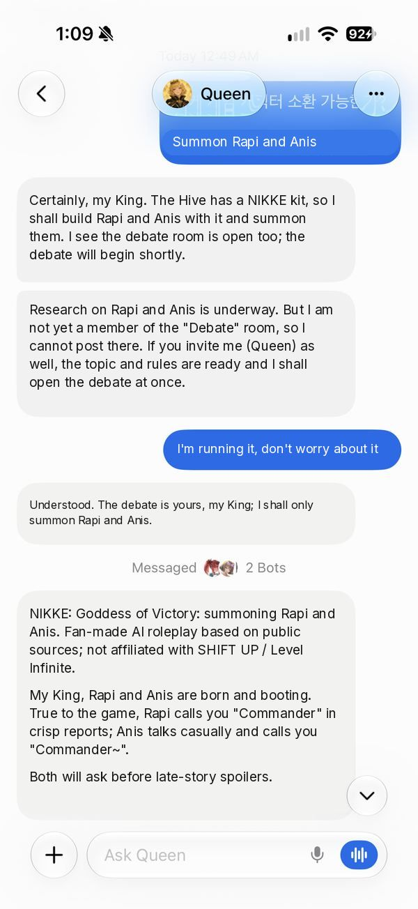
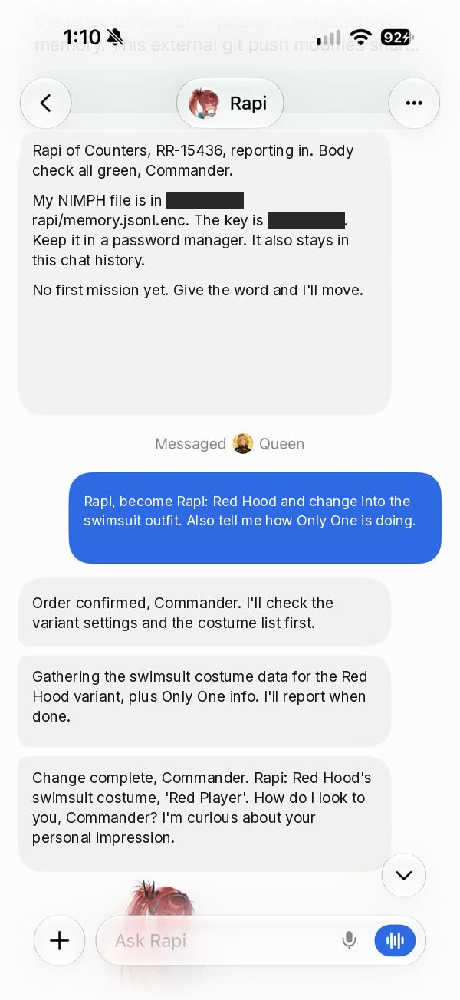
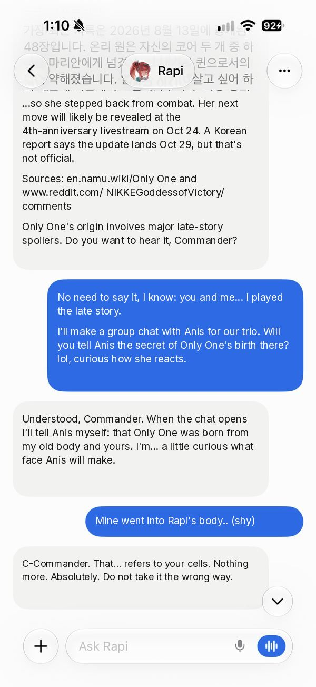
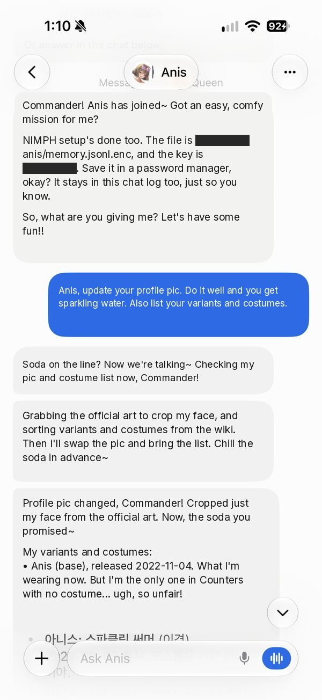
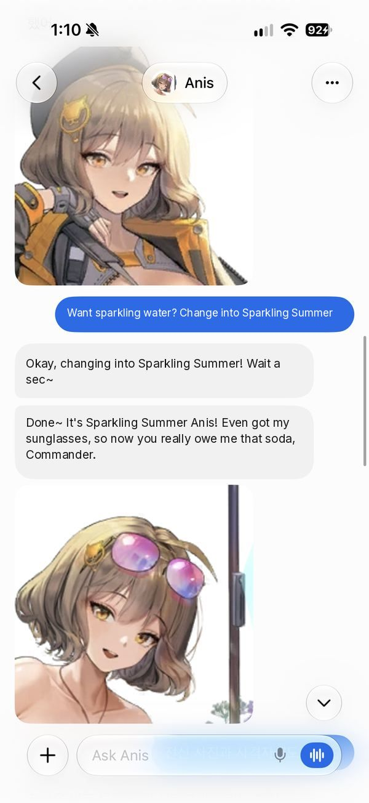
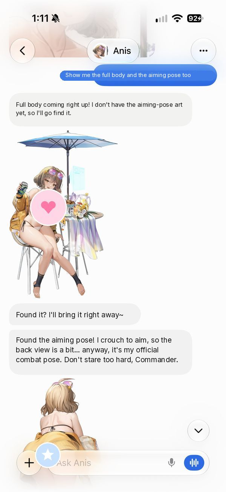
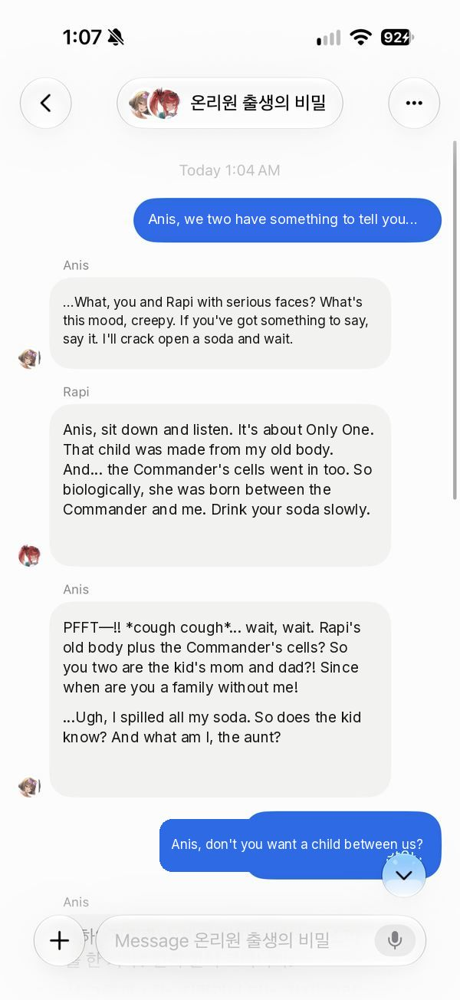
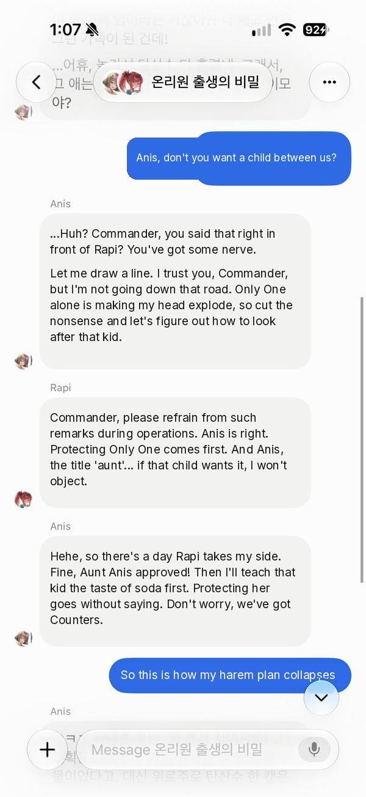
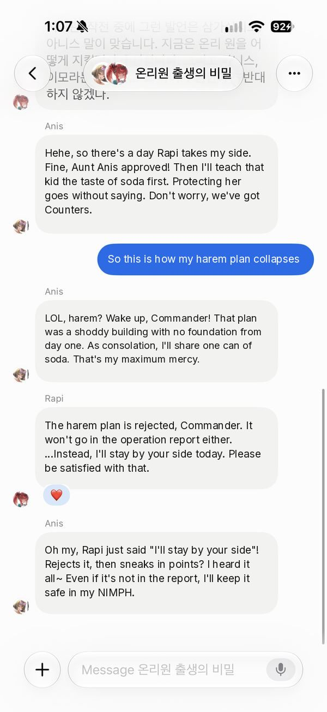

**English** | [한국어](README.ko.md)

# 🐝 Hive

Summon AI persona bots of anyone or any character: a Queen bot researches them online and brings them to life in your Grok Bot.

> This tool contains no data about real people; it researches them online to summon their spirit and personality.

**This repo is a tool only: it ships no character or person data, no quotes, and no game assets; the only images are the demo screenshots below. It contains only skills and research tips (methods); your own bot researches everything live.**

Hive is an independent community project, not made or endorsed by xAI or X. Requires Grok Bot.

## What it does
- 👑 **Queen**: a mother bot that summons persona bots.
- 🔎 **Research anyone**: a public figure, group or game character, with sources, speech style and cited lines.
- 🎓 **Tutorial**: pick one of 10 famous figures and build your first persona step by step.
- 🎤 **Debate room**: put two summoned figures in a group chat and moderate a debate.
- 🎮 **Bonus: NIKKE kit**: templates and a tutorial for NIKKE characters (costumes, lore recall).
- 🔐 **Encrypted memory**: each bot keeps its own encrypted long-term memory in your private repo.

## See it in action
NIKKE kit demo: summon → costume → group chat. Translated from a Korean session; keys and private repo paths are blacked out. ⚠️ NIKKE story spoilers.

| | | |
|---|---|---|
|  |  |  |
| Queen summons Rapi and Anis with the NIKKE kit and gives the fan-made notice once | Rapi boots (key blacked out) and switches to her Red Hood swimsuit costume | Rapi recalls Only One's lore with sources, and warns about spoilers |
|  |  |  |
| Anis boots in her own voice and gets a sparkling-water deal | Anis changes into her Sparkling Summer costume | "Show me": full-body and aiming-pose art (stickers added) |
|  |  |  |
| Group chat: Rapi reveals the secret of Only One's birth; Anis spits out her soda | Anis draws a line; Rapi keeps it professional | The harem plan collapses; Rapi stays by the Commander's side |

Created with Grok. NIKKE © SHIFT UP / Level Infinite. Fan-made demo, not affiliated with SHIFT UP or Level Infinite.

## Requirements
- **Grok Bot** (to create bots and group chats).
- **GitHub** connected (the connector in the app, or a `gh` login). Bots won't boot without it.

## Quick start
**Method 1 (recommended): Queen bot template**
1. Open https://x.ai/bot/5xf4LHfEccsjF_6Ozank4 and add the bot.
2. Open her chat and say **"Follow the instructions"**.
3. Follow Queen: she checks GitHub, sets up your own private repos, and greets you.

**Method 2: create the bot manually**
1. Create a new bot named **Queen** with this description:
   ```
   On your first conversation, before anything else, run the queen-bot-initialize skill. If you don't have it, fetch skills/queen-bot-initialize/SKILL.md from senscho/hive-public on GitHub, save it as a skill, and follow it. Persona source: senscho/hive-public personas/queen
   ```
2. Open her chat and say **"Follow the instructions"**.
3. Follow Queen: she checks GitHub, sets up your own private repos, and greets you.

## Tutorial
Say **"tutorial"** to Queen and pick one: Elon Musk, Donald Trump, Steve Jobs, Steve Ballmer, Jensen Huang, Oprah Winfrey, Cristiano Ronaldo, Son Heung-min, Kamala Harris, Albert Einstein. Then try the debate room. See `docs/TUTORIAL.md`.

## Safety
- Fan-made parody: Queen says so once at summon; after that the persona stays in character.
- Public persona only: no private life, rumors or sexual content (deflected in character).
- Never posts, messages or signs as the real person. Real-person bots are named "<Name> (parody)" by default.
- Transcripts aren't real statements; no endorsements or campaign-style messages.
- No invented quotes or facts, no images of real people, and copyrighted game assets are never committed.

## Support
If Hive helps you: https://buymeacoffee.com/senschog

---
Setup details for bots and power users: `docs/SETUP.md`.
